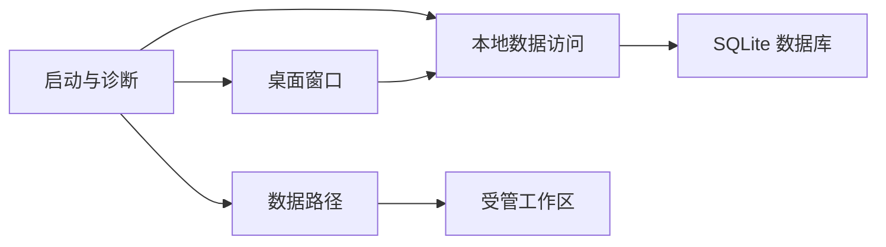

# 架构说明

当前版本采用 Python 3.12、Qt Widgets 和 SQLite。架构决定见 [Windows 桌面方案](adr/0001-windows-desktop.md)。

| 模块 | 当前职责 |
| --- | --- |
| `filemind.__main__` | 解析启动参数，初始化数据目录，启动窗口或输出诊断 |
| `filemind.ui` | 四页导航、右侧详情、本地运行状态和打开数据目录 |
| `filemind.config` | 默认应用数据路径与显式 `--data-dir` |
| `filemind.storage` | 事务初始化、数据库结构版本、FTS5 探测和界面偏好 |
| `tests/` | 诊断入口、数据库持久化、结构版本保护和 Qt 点击测试 |

应用启动时用 SQLite `user_version` 校验结构版本。版本 1 只持久化界面偏好。初始化通过事务执行，FTS5 探测使用临时表。应用无法识别数据库版本时停止打开该数据库。

## P0/P1 接入方式

- 导入、扫描、解析、检索、问答和整理逐步在应用服务中实现。窗口负责收集输入和呈现结果，耗时文件处理和模型调用交给后台任务。
- SQLite 保存文件、文本块、索引任务、向量、计划和操作记录。文件身份、内容版本和模型指纹随索引更新。扫描和文件移动的失败保留可恢复状态。
- 文档预览按来源位置渲染文本。远程模型只接收限定证据，整理执行器只接受经确认且仍有效的计划。
