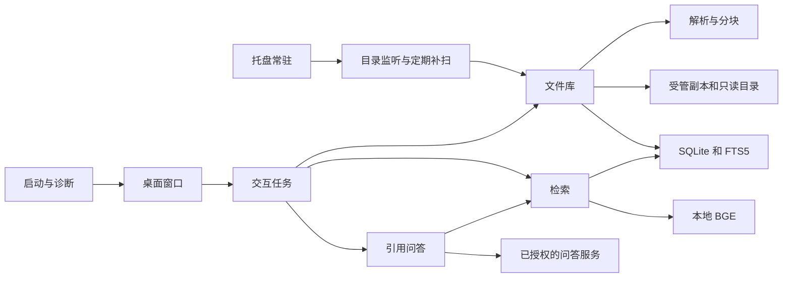

# 架构说明

当前版本采用 Python 3.12、Qt Widgets 和 SQLite。架构决定见 [Windows 桌面方案](adr/0001-windows-desktop.md)。

| 模块 | 当前职责 |
| --- | --- |
| `filemind.__main__` | 启动、诊断、下载模型及数据目录锁 |
| `filemind.ui` | 桌面交互、索引任务、检索结果、引用和纯文本预览 |
| `filemind.config` | 默认应用数据路径与显式 `--data-dir` |
| `filemind.library` | 保存受管副本、检查来源权限、扫描、重试及原文校验 |
| `filemind.documents` 和 `filemind.text_index` | 格式解析、位置与原文保留、WordPiece 分块及 jieba 分词 |
| `filemind.continuous` | 监听目录、合并变更、分批补建内容和向量 |
| `filemind.file_metadata` 和 `filemind.windows` | 压缩包目录、EXE 版本资源、Windows 目录解析和登录启动 |
| `filemind.storage` | 数据库迁移、资料库状态、原文、FTS5 和向量 |
| `filemind.search` 和 `filemind.embeddings` | 文件级 BM25、余弦相似度和 RRF 排序 |
| `filemind.qa` | 限定证据、调用问答服务并核验引用 |

SQLite 结构版本 4 增加文件 SHA-256 索引和 Office 解析版本。每个数据目录由一个桌面进程管理。SQLite 使用 WAL 支持扫描时读索引。交互文件写入与后台目录索引共享调度。向量按不可复用的文本块 ID 写入，文件内容更新后旧块的向量写入自动跳过。源码环境的资料库、权重和临时文件位于仓库的 `data/`。

## 文件与索引

- 导入先记录待接入文件，再在独立子目录保存同名副本。复制完成后启动索引，重启可继续处理中断的任务。关联目录保存授权的绝对路径，目录取消关联时仅清除应用内的记录和索引。
- 启动和手动刷新读取文件快照，使用 SHA-256 识别内容变化。同一路径更新内容或 Office 解析版本时保留文件 ID 并增加内容版本。解析成功后事务提交原文、分块和 FTS5 索引。来源扫描完整时才清理缺失文件的索引。明确命中排除规则的记录连同派生索引一起清除。
- 目录扫描每 256 个文件提交名称索引，全文随后分批补建。监听器合并路径变更，约每 2 秒处理一批。定期补扫间隔 10 分钟，可补齐漏报并重连暂不可访问的来源。文件库分页，内容与向量索引均在后台执行。
- 正文和导入副本上限 32 MiB。PDF 与 Office 解析由独立子进程执行，时限 25 秒。Office 部件总解压上限 128 MiB，单个 XML 上限 8 MiB。PDF 和 PPTX 最多 1000 页或张，提取文本最多 200 万字符。跳过应用数据目录、链接、重解析点和常见敏感配置名称。
- ZIP、7Z、RAR 和 TAR 等只读取目录条目，上限为 1000 项或 128 KiB。EXE 使用 Windows 版本资源。它们可以做关键词与名称检索，问答的证据范围限文档正文。
- 原文按 PDF 物理页、PPTX 幻灯片、Word 段落与表格、Excel 行和文本行保存。Word 相邻短段、短表格单元及相邻 Excel 行可合并，引用保留相应范围。使用 BGE 的 WordPiece 词表切为最多 384 token 的块并保留原文偏移。改用新版 Office 分块的文件在生成向量时加入文件名与已有标题。FTS5 单独保存分词后的术语，`FIRST/FOLLOW`、`B+`、`C++` 和扩展名以完整词项匹配。

## 检索与问答

- 关键词分支用 BM25，语义分支用本地 BGE 的 CLS 向量和余弦相似度。向量生成与目录扫描分别在后台运行，语义检索共用同一推理实例。Windows x64 首选 DirectML，CPU 作为回退。GPU 每次推理最多 32 个文本块，每次读写合并最多 128 个，按模型指纹缓存。两分支先按文件取最相关文本块，混合模式按文件排名做 RRF。来源、格式和文件范围在两分支使用同一组过滤条件。
- 检索检查候选文件的状态，预览和引用核对当前 SHA-256、内容版本和文本。启用远程问答后，服务最多发送 6 条摘录，每条不超过 900 字符。返回的引用须匹配发送的块 ID、内容版本和逐字摘录。问答调用只具备文本输入和文本输出。
- 关键词优先查找全词项命中。三个及以上词项的查询可放宽，在限定范围内先按 BM25 取候选，再要求同一个块的文件名和正文合计命中至少一半词项。BM25 提高文件名命中的权重。
- 语义分支过滤低余弦分数，按批向量化计算，并在首次查询时加载当前范围的向量矩阵。后台提交新向量时，最近的新增块可增量载入。删改已有向量、范围切换或超过缓存上限时重新分批读取。无向量文件的索引写入继续复用缓存。完全相同的文件在分块和向量输入一致时复用已生成的向量。内容检索在融合前按 SHA-256 折叠非空文件，文件名与路径检索逐个返回匹配文件。
